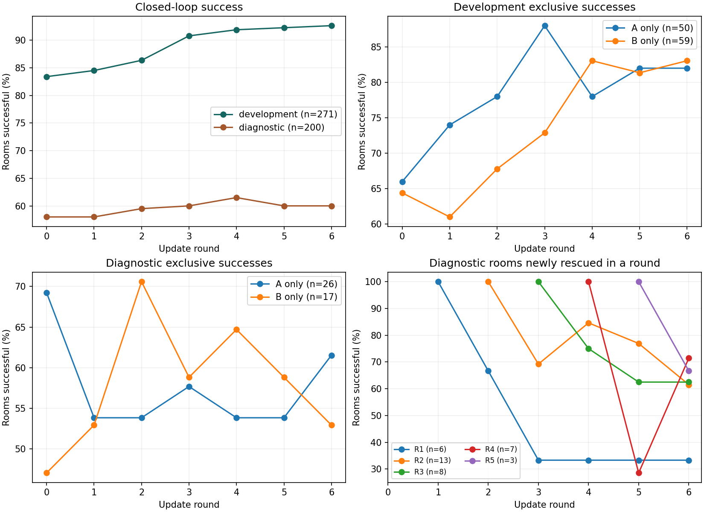

# 在相同开发并集上继续到第 6 轮

从冻结第 2 轮接续，训练房间、抽样规则、每轮 300 次更新、优化器、保留损失与仿真预算沿用此前定义。新增四轮预先固定，独立确认的主比较是第 6 轮相对第 2 轮。模型每轮只用当轮配对数据。从特定的一份 seed17 蒸馏模型开始。

| 面板 | 房间 | 第 0 至 6 轮成功数 |
|---|---:|---|
| 开发成功并集 | 271 | 226 → 229 → 234 → 246 → 249 → 250 → 251 |
| 已查看的自然诊断房间 | 200 | 116 → 116 → 119 → 120 → 123 → 120 → 120 |
| 诊断中仅 A 成功 | 26 | 18 → 14 → 14 → 15 → 14 → 14 → 16 |
| 诊断中仅 B 成功 | 17 | 8 → 9 → 12 → 10 → 11 → 10 → 9 |

诊断面板第 2 轮相对第 1 轮新救回 13 个，之后在第 2 至 6 轮各有 13 → 9 → 11 → 10 → 8 个成功。从第 2 轮开始一直到第 6 轮每一版都成功的有 7 个。图中按相邻轮的失败转成功划分集合，同一房间可在不同轮次再次被救回。

## 全新 200 房间

| 分组 | 房间 | 第 0 轮 | 第 2 轮 | 第 6 轮 |
|---|---:|---:|---:|---:|
| all | 200 | 110 | 111 | 104 |
| A_only | 15 | 8 | 8 | 7 |
| B_only | 31 | 18 | 22 | 18 |
| both | 78 | 75 | 74 | 73 |
| neither | 76 | 9 | 7 | 6 |

第 6 轮相对第 2 轮救回 5 个，丢失 12 个；净差 -3.5 个百分点，配对 95% 区间 [-7.5, +0.5]，双侧 McNemar p=0.143。区间按房间配对重采样 4,000 次。两位专家在同场从头独立执行，用于标记能力分组；预先冻结的三个 actor 均实际执行完整闭环。

[逐房间结果](rooms.csv) · [旋转与镜像诊断](symmetry.md) · [翻转机制与干预](mechanism.md)
