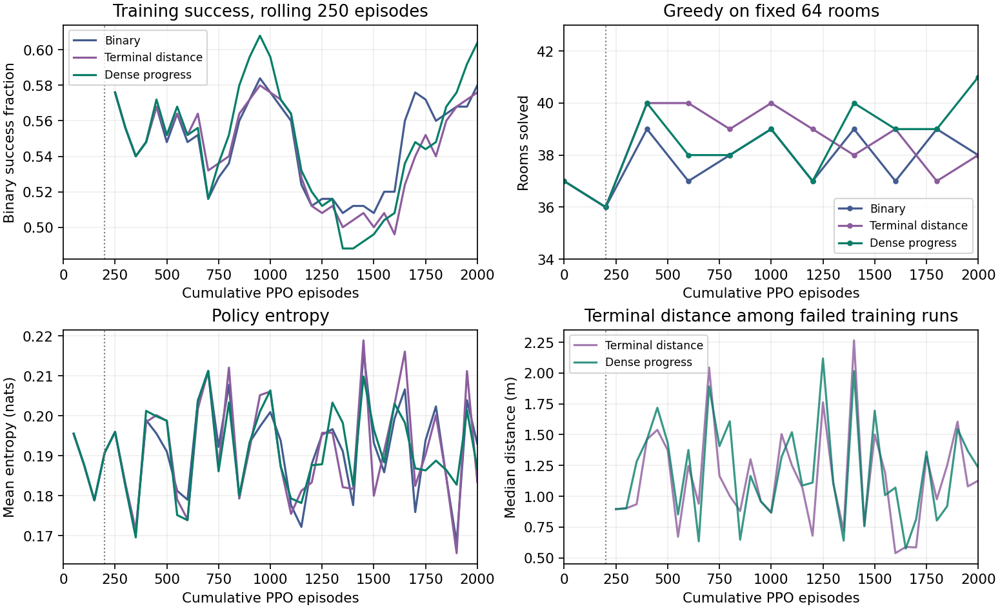

# A/B/C PPO 的逐 option 进展奖励

共同的 200 局父模型成功 105/200。同房间的 2,000 局末轮为二元奖励 **100**、终端距离 **99**、逐 option 进展 **98**。进展组相对二元组成功率差为 **-1.00 [-5.50, +3.00] 个百分点**。

| 累计 PPO 局 | 固定 64 间 二元 | 固定 64 间 终端距离 | 固定 64 间 逐步进展 |
|---:|---:|---:|---:|
| 0 | 37 | 37 | 37 |
| 200 | 36 | 36 | 36 |
| 400 | 39 | 40 | 40 |
| 600 | 37 | 40 | 38 |
| 800 | 38 | 39 | 38 |
| 1,000 | 39 | 40 | 39 |
| 1,200 | 37 | 39 | 37 |
| 1,400 | 39 | 38 | 40 |
| 1,600 | 37 | 39 | 39 |
| 1,800 | 39 | 37 | 39 |
| 2,000 | 38 | 38 | 41 |

| 逐步进展末轮相对 | 救回 | 丢失 | 成功率差及房间配对 95% 区间（百分点） |
|---|---:|---:|---:|
| 二元奖励末轮 | 8 | 10 | -1.00 [-5.50, +3.00] |
| 终端距离末轮 | 7 | 8 | -0.50 [-4.50, +3.00] |
| 共同 200 局父模型 | 5 | 12 | -3.50 [-7.50, +0.50] |

| 终距比较 | 房间数 | 参照中位数（米） | 逐步组中位数（米） | 平均配对差及 95% 区间（米） |
|---|---:|---:|---:|---:|
| 对二元奖励，全部房间 | 200 | 0.195 | 0.221 | +0.009 [-0.046, +0.064] |
| 对二元奖励，两组均失败 | 92 | 1.502 | 1.338 | +0.003 [-0.101, +0.113] |
| 对终端距离，全部房间 | 200 | 0.207 | 0.221 | -0.050 [-0.124, +0.022] |
| 对终端距离，两组均失败 | 94 | 1.552 | 1.257 | -0.074 [-0.193, +0.048] |

每靠近 1 米给 0.10，后退给 0。进展分逐次累加。追加的 1,800 局中，进展奖励平均 0.224，最大 0.505，有 0 局达到 1。成功额外给 1。
逐步与二元组在 36 个相同批次的成功数相关为 0.913。两组首批共享行为轨迹时，actor 参数更新方向余弦为 0.959，更新幅度比为 1.001。36 次更新的余弦中位数为 0.478，后期策略访问的前缀可能已经不同。这里比较实际 Adam 参数步。每 200 个房间按生成种子产生并洗牌，连续 50 间为一批。每 200 间内 2–5 个可移动物体各 50 间，各批的物体数构成和难度可以浮动。
首批 50 局关闭进展奖励后，所得 actor 和 critic 与旧二元基线逐值一致。三个分支沿用同一批训练房间、父模型、采样与选模规则。两批评测房间此前已查看，区间按房间配对重抽，以固定 seed 17 和奖励参数为条件。

[实验协议](plan.md) · [逐房间结果](rooms.csv) · [配对统计](results.json)
