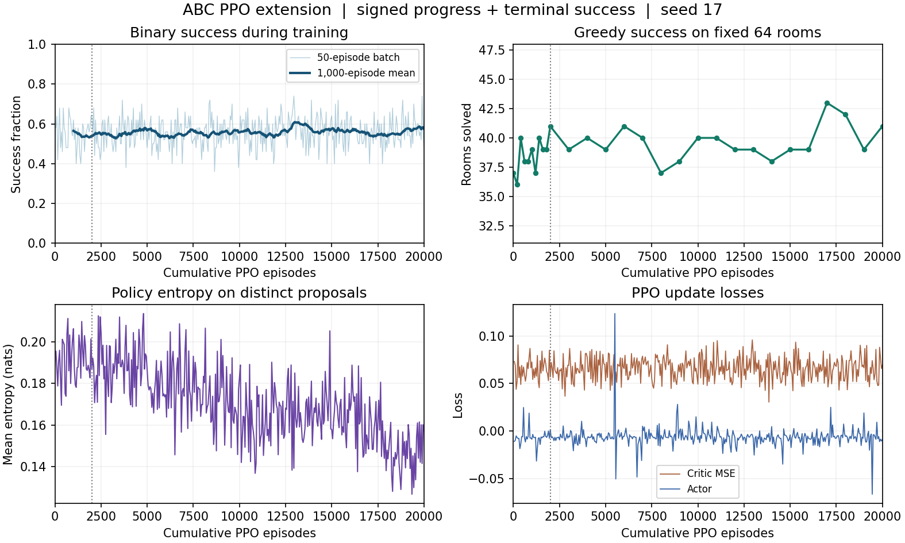

# A/B/C PPO 的 20,000 局新房间续训

冻结的新 200 间上，2,000 局父模型成功 **105/200**，20,000 局末轮成功 **107/200**。末轮救回 15 间、丢失 13 间，配对差为 **+1.00 [-4.00, +6.00] 个百分点**。

| 模型 | 成功 / 200 |
|---|---:|
| 纯 A | 96 |
| 纯 B | 102 |
| 纯 C | 97 |
| 监督起点 | 96 |
| PPO 200 局 | 95 |
| PPO 2,000 局（续训起点） | 105 |
| PPO 20,000 局（预定末轮） | 107 |

固定诊断 64 间的续训起点与末轮分别为 41 和 41，中间及末轮最高为 43。追加阶段首个与最后一个完整 1,000 局训练窗口的随机策略成功率为 54.1% 和 57.5%。训练窗口用不同房间，固定诊断房间用于核对部署曲线，独立主比较使用预登记的末轮。

| 独立面板专家成败分层 | 房间 | 2,000 局 | 20,000 局 |
|---|---:|---:|---:|
| 仅 A 成功 | 8 | 4 | 3 |
| 仅 B 成功 | 9 | 5 | 5 |
| 仅 C 成功 | 11 | 4 | 5 |
| 三位专家均失败 | 74 | 10 | 9 |

从固定 seed 17 的正向进展父模型恢复 actor、critic 与 Adam。每轮以新种子生成并选 50 个新房间。追加 18,000 个哈希唯一的房间，与固定诊断和末轮确认房间均无重合。奖励是每米 0.10 的有符号距离缩短，另给终端成功 1。配对区间按房间重抽。本次同时延长训练、扩大场景覆盖和加入退步惩罚，结论以这一训练设置和种子为条件。

[协议](plan.md) · [逐房间结果](rooms.csv) · [逐轮记录](training.csv) · [配对统计](results.json)
