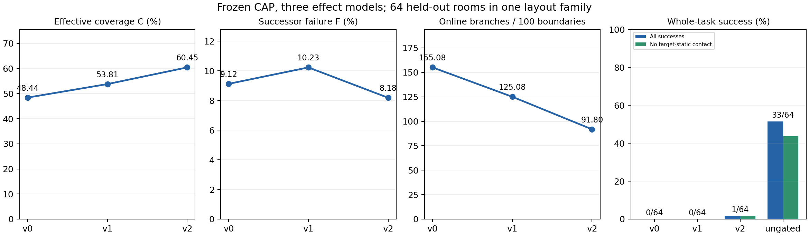

# 可抽取 CAP 规则与预测模型迭代

框架及三版冻结闭环已实现。局部主假设的配对区间支持：True。但 v2 整局只成功 1/64，同一 CAP 不加预测门为 33/64；v2 仍有 14/64 间出现箱体静态接触。当前结果没有实现安全保证与较高整局完成率的兼顾。

同一份字面量规则驱动运行和符号检查。作者程序冻结后，仅更新效果模型；确认集没有用于拟合或选策略。以下结果仅适用于 compact20 的固定对角起点布局族。



## 配对候选结果

|模型|候选/边界|放行|有效覆盖 C|接续失败 F|每百边界在线分支 K|放行后静态接触|
|---|---:|---:|---:|---:|---:|---:|
|v0|1024/1280|603|48.44%|9.12%|155.078|87|
|v1|1024/1280|655|53.81%|10.23%|125.078|70|
|v2|1024/1280|721|60.45%|8.18%|91.797|74|

C 的分母是全部固定受测候选，分子是获准且无箱体静态接触、实际后继完成的候选。F 只衡量获准后的接续未完成；接触另列。无放行时 F 未定义。停止不算有效覆盖。K 计入根边界与实际后继决策的全部在线分支，分母也包括这两类真实受测边界；一个边界试算五个分支计五次。
候选池包含宿主提供的替代档位；metrics.json 同时给出仅含作者规则动作的 authored_C/F，以及只含原始首选的 nominal_first_C。候选覆盖不能替代下表的真实整局执行结果。

|比较|ΔC，百分点 [95%区间]|ΔF，百分点 [95%区间]|ΔK [95%区间]|
|---|---|---|---|
|v1−v0|5.37 [3.12, 7.71]|1.11 [-0.50, 2.93]|-30.000 [-36.797, -22.734]|
|v2−v1|6.64 [4.00, 9.47]|-2.05 [-4.17, -0.04]|-33.281 [-44.537, -23.672]|
|v2−v0|12.01 [8.20, 16.02]|-0.94 [-4.12, 1.77]|-63.281 [-75.475, -51.797]|

预定容差为 C 下降不超过 5 个百分点、F 上升不超过 5 个百分点，且 K 严格减少。点估计同时满足：True；房间配对区间同时支持：True。区间为 2000 次按房间重采样的 95% 百分位区间。

## 预测更新与放行依据

|模型|拟合房间|效果记录|有数值校准的动作|模型直接放行|在线经验放行|模型放行子集联合覆盖|实测承诺违约|
|---|---:|---:|---:|---:|---:|---:|---:|
|v0|8|2515|4|400|203|91.00% (n=400)|82|
|v1|24|7633|8|536|119|92.72% (n=536)|65|
|v2|48|12855|9|664|57|88.40% (n=664)|69|

联合覆盖同时核对所有已预测语义量与过程安全标签。最后一列在全部放行候选中检查实际效果承诺和实际后继启动条件，与 F 的“后继是否按时完成”不同。数值校准动作数只表示有校准数据，不表示满足联合风险上界。

|版本变化|保留放行|撤回放行|新增放行|继续暂缓|
|---|---:|---:|---:|---:|
|0->1|564|39|91|330|
|1->2|639|16|82|287|
|0->2|556|47|165|256|

|版本|根动作类型|候选|放行|安全且后继完成|放行后继未完成|
|---|---|---:|---:|---:|---:|
|v0|push|410|323|277|18|
|v0|orbit|614|280|219|37|
|v1|push|410|316|284|15|
|v1|orbit|614|339|267|52|
|v2|push|410|321|292|12|
|v2|orbit|614|400|327|47|

v2 的 614 个实测绕行候选中，实际选中的 PUSH 从绕行前不可启动变为可启动的有 0 个，其中后继完成 0 个。这是全部强制候选的诊断，含未放行候选。作者开发阶段的新法向案例另见 author_summary.json，不能当成新确认房的机制泛化证据。


## 从头执行的整局结果

|版本|整局成功|无箱体静态接触的成功|有箱体静态接触的房间|平均任务成本（秒）|在线分支|决策边界|K|执行异常|
|---|---:|---:|---:|---:|---:|---:|---:|---:|
|0|0/64|0/64|16/64|180.000|4750|27279|17.413|0|
|1|0/64|0/64|15/64|180.000|3673|27500|13.356|0|
|2|1/64|1/64|14/64|177.673|1569|27061|5.798|0|
|ungated|33/64|28/64|31/64|106.663|0|12018|0.000|0|

ungated 为同一冻结 CAP、不使用预测放行门的参考。失败成本固定为环境时间预算的两倍；运行异常留在分母。逐房间的停止、接触、物理 ticks、在线预算耗尽与仿真起点不相容见 rooms.csv。

|版本|停止命令/全部边界|出现在线预算耗尽的房间|在线假设构造数|未通过相容检查|在线耗时（秒）|
|---|---:|---:|---:|---:|---:|
|0|24325/27279|64/64|73743|68993|3846.534|
|1|24971/27500|64/64|69811|66138|3846.486|
|2|24191/27061|63/64|72133|70564|3799.080|
|ungated|222/12018|0/64|0|0|0.000|

K 应与有效覆盖、整局完成和停止量一起解释。在线几何构造及相容检查也消耗计算时间；未执行物理分支的构造不计为 rollout 分支，单独列在这里。墙钟上限在分支边界检查，可能有一个分支的超限；运行负载也可能影响何时触及墙钟预算，因此冻结程序和随机种子不等于逐位重现墙钟受限决策。

在线假设仿真另有 24 次被捕获的 `push_no_legal_face`，集中在 12 次接续查询；这些查询的放行数为 0，均未取得有效后果样本。错误分支保留预算记账，不计为成功证据。这与真实物理评估的执行异常分开报告，详见 online_error_audit.json。

## 一个完整任务的配对案例

按房间名排序，v2 首个无箱体静态接触的成功是 `diag_symbolic_confirmation_003`。这是预定确认集中的单个例子，不能替代全部房间的分母；对应真实轨迹见回放。

|版本|完成|真实向目标净推进（米）|停止命令|模型放行|在线物理分支|
|---|---:|---:|---:|---:|---:|
|0|False|2.971|338|6|207|
|1|False|1.883|371|8|135|
|2|True|3.885|4|74|75|
|ungated|True|3.888|0|0|0|

## 实现与证据边界

- 元表达式带单位；选择规则、评分和并列顺序可抽取。检查器预测联合后果后重新计算实际选择。未预测的受影响值成为 unknown。
- 对任意运行期非停止权限，检查每个启用规则蕴含其执行条件，并检查规则覆盖。该证明只保证启动条件，不保证动作完成或物理安全。编译 CAP 与解释器的首命令在宿主选定的开发中途边界逐项核对。
- 作者的效果承诺位于 policy.py 的 SYMBOLIC_POLICY.expect；模型只预测公开语义摘要与过程接触标签。有限联合模式保留离散关联，模式内连续区间是保守包络。
- v0/v1/v2 逐批增加开发房间；用前一冻结版实际运行，在不确定或停止边界补采。缺少局部支持、预测后果改变放行判断的案例优先进入下一版，并加入固定高置信抽查。校准房与拟合房分离，但校准房也用于开发诊断，不是最终确认集。开发采样与在线仿真分别计费。
- 在线仿真从公开回波拟合箱体，并使用历史静态回波，构造多个未知深度假设。假设须通过声明的 8 cm 测距/自由空间容差检查；这属于近似观测约束，并未证明与全部无噪声历史严格相容。不使用真实执行状态克隆。已有预测反例未被排除时，名义成功不能覆盖它；在线后果与保留的预测模式一起检查。未观测空间、形状完备性与控制器冷启动仍无覆盖保证，所以此处是经验放行。
- 每个候选先保存预测，再实际从同一物理前缀执行。接续由冻结策略选择，最多重复该命令 120 ticks：PUSH 向目标净推进至少 2 cm；绕行得到目标方向可执行 PUSH；MOVE 两台机器人沿指令方向各移动至少 5 cm。整局评估则在每一真实边界重新选择。
- 符号证明相对于给定效果集合成立。0.10 是冻结筛选阈值；逐分量数值残差校准不构成联合 90% 覆盖保证，也不是获准子集的违约率上界。经验集合（含过程安全标签）的真实覆盖率和获准子集违约见 metrics.json。零次观测碰撞也不等于零风险。
- 几何版本为直径 20 cm、绕行目标净距 5 cm、当前可见面 PUSH 法向阈值 45°、72 条机体坐标射线。5 cm 是控制目标，不是已证明的硬安全下界。

## 复核入口

- [逐房间表](rooms.csv) · [同前缀候选](paired.csv) · [真实执行回放](replay.html)
- [四类逐步检查案例](worked_cases.md) · [案例完整数据](worked_cases.json)
- [动作类型与绕行后新可执行 PUSH](action_strata.json) · [作者开发记录与局部探针](author_summary.json)
- [模型迭代指标](metrics.json) · [修改影响复查](model_recheck_summary.json) · [运行期选择条件证明](runtime_selection_proof.json)
- [作者程序修订依赖](program_rechecks.json)（含竞争规则可能被改选的保守影响范围）
- [157 个基础量的单位、来源、刷新与失效约定](semantic_registry.json)
- [逐 tick 原始位姿复算](raw_replay_audit.json) · [开发、离线、在线仿真账目](cost_accounting.json) · [正式冻结前的宿主修订](host_amendments.json)
- [工程与证据复核](validation.json)：25 项框架检查及包含它们的 59 项相关检查通过；没有宣称运行全仓测试。
- [分析依赖](analysis_environment.json)：物理评估结束后补装 SciPy 1.15.3，用于二项风险区间分位数；保留原始缺依赖报错，NumPy 与策略执行源码未改。
- [在线假设异常复查](online_error_audit.json)：逐查询保留发生原因、样本数和最终放行决定。
- [冻结策略](policy.py) · [作者提交与源指纹](policy_frozen.json) · [模型指纹](models.json) · [冻结协议](protocol.json)
- [单房间重放脚本](reproduce_one.py)：在仓库根目录运行，先校验全部冻结输入，结果写到新文件，不覆盖历史记录。

```bash
.venv/bin/python docs/research/key_findings/2026-11-25_symbolic_general/reproduce_one.py --version 2 --room diag_symbolic_confirmation_003 --output /tmp/cap-symbolic-room003.json.gz
```

原始记录目录：`/home/tzl/repo/coimagine/outputs/semantic_rl/cap_symbolic_general_v1`。作者 campaign verify_frozen：`20bf115b1705ccf7dcdedb7ee250c8b4acebacba62fad77cb2af920fbfb19367`。
