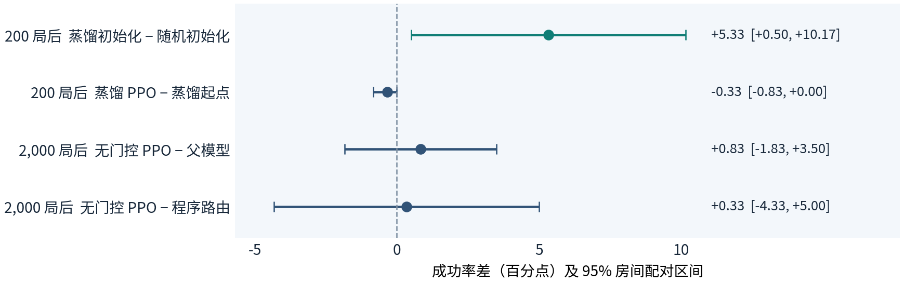

# CoImagine 阶段汇报｜多专家程序策略的闭环组合

**2026 年 11 月 24 日 · 导师讨论稿 · 实验截至 11 月 23 日**

## 1. 研究问题与当前进展

在连续二维双机器人协作推运中，能否让多个由 LLM 编写的冻结专家共享能力？每到一个 option 边界，两位专家分别基于同一条公开历史提出命令，路由器选择一条执行，再根据实际反馈决定下一步。局面改变后，两位专家继续根据真实执行历史更新各自的记忆。评估记录整局是否完成任务。

- **闭环切换可以产生新解。** 当前确认面板有 79 间房，A 和 B 从初态各自执行都失败。冻结程序路由解出其中 8 间，蒸馏 actor 解出 10 间。两者都成功 111/200，最佳单专家为 102/200。
- **蒸馏传递了可部署的切换能力。** 在同网络、同语义输入和同门控下，蒸馏起点比三个随机初始化平均高 5.50 个百分点。各在线训练 200 局后，差距仍为 5.33 个百分点。
- **在线训练的增量仍待证实。** 蒸馏后短程 PPO 没有救回一间原失败房间。从已训练的分叉 actor 出发，无门控 PPO 每种子跑 2,000 局，确认面板平均提升 0.83 个百分点，区间跨零。

## 2. 当前同房间闭环对照

| 方法 | 诊断面板 / 200 | PPO 确认面板 / 200 |
|---|---:|---:|
| 单专家 A / B | 107 / 113 | 102 / 101 |
| 两位单专家的成功并集 | 136 | 121 |
| 首次分歧起 B 执行 5 条命令，再交 A | 121 | 106 |
| **冻结 LLM 程序路由** | **125** | **111** |
| **冻结蒸馏语义 actor** | — | **111** |
| 蒸馏 actor ＋ PPO 200 局 | — | 111 / 111 / 109 |
| 随机语义 actor ＋ PPO 200 局 | — | 102 / 99 / 98 |
| 预先分叉训练四轮的父 actor | 114 / 116 / 111 | 108 / 114 / 108 |
| 父 actor ＋一轮分叉监督与软保持 | 110 / 114 / 118 | 109 / 116 / 108 |
| 父 actor ＋无门控 PPO 2,000 局 | 111 / 121 / 115 | 110 / 114 / 111 |

每列为同一批 200 个不同房间，三种子顺序为 17、29、43。两批面板均使用同一对冻结专家、固定 72 束雷达、局部坐标中心估计、同一 option 执行器及终止预算。确认面板原为无门控 PPO 预留，程序路由和短程 PPO 属于后续补充对照。纯专家并集是事后逐房间选择的覆盖参考。程序路由和蒸馏组沿用公开停滞前执行 A 的门控。无门控 PPO 从首次不同提案起可切换，屏蔽九个教师语义量。两者可比较实际部署表现，初始化的独立效应由同门控的短程对照估计。[完整横向评估](../../key_findings/2026-11-23_distilled_ppo/panel_comparison.md)

---

## 3. 策略切换为何有价值，首次分歧为何难选

**同一房间里的路线互补包含两种机会。** 一种是保住某个专家独有的成功路线。另一种是让一个专家完成站位、准备或脱困，再把实际到达的局面交给另一个专家，走出两条纯执行路线都没有的后缀。在当前诊断面板，两个固定五步交接方向合计解出 64 个双败房间中的 16 个。确认面板上，程序路由在专家并集的 121 间里保住 103 间，另解出 8 间双败房间。蒸馏分别为 101 和 10 间。两者各有 11 间对方没解决。[五步交接诊断](../../key_findings/2026-11-23_first_choice_transfer/README.md) · [确认面板逐房间结果](../../key_findings/2026-11-23_distilled_ppo/rooms.csv)

**较早的公开前缀对长期胜负区分有限。** 当前诊断面板上，专门预测纯 A、B 谁赢的线性评分器，在 52 个独胜房间的首次分歧处 AUC 为 **0.465**，95% 区间 [0.312, 0.624]。在两路各走 10 条命令后、都还在运行且能看到目标的 48 间，真实物体余距的 AUC 达 **0.762**。相同 48 间在首次分歧时的评分 AUC 为 **0.497**。双路线后续观测由离线分叉取得，支持“结果可在较晚阶段显现”的解释。它不提供部署时可直接读取的预测信号。[首次分歧与真实后缀](../../key_findings/2026-11-23_first_choice_transfer/README.md)

**局面图适合帮作者定位瓶颈。** 较早一组专家的物理审计中，满足所需侧面接触的 PUSH 有 46/49 达到推进标准，其余为 31/96。六类局面能描述这类前置条件，但在接手诊断中，即使事后知道真实簇、为每簇统一选专家，也只从持续执行 A 的 194/400 增至 195/400。逐前缀回看两条实测后缀选胜者可达 223/400。这一差距说明，粗簇内部仍有决定接手成败的上下文差异。[物理拓扑与实际交接](../../key_findings/2026-11-23_cap_topology_graph/README.md)

## 4. 程序教师如何转化成统计学习的起点

1. 冻结通用专家 A，再让作者以 A 的代码为基础、参考其停滞前缀开发 B。两个完整程序都可单独执行。
2. 给路由作者两份源码、公开接口和开发记录。作者在固定 24 间上提交三版，试跑成功数从 **12 → 15 → 18**。冻结版在原始独立 200 间达到 **118**，同期 A、B、固定接手、图路由分别为 **102、106、109、104**。原实验使用旧中心估计和另一批房间。
3. 在 400 个开发房间上记录教师实际访问的 6,898 个可改选边界。64×64 actor 读取公开几何、A/B 提案、短历史和九个提案比较量，拟合 A/B 选择。原蒸馏留出教师前缀的一致率为 **90.6%**。当前确认面板的 **111/200** 来自学生自己访问的闭环前缀。

阶段性的论文主张可以限定为：**用可读程序描述专家的交接规则并蒸馏，可以在同一任务中组合两位冻结专家的能力。** 当前证据来自一个专家对和一位路由作者。要估计迭代试跑、语义量和记忆分别贡献多少，还需新增匹配的独立对照。[B 的开发与接手](../../key_findings/2026-11-23_authored_handoff/README.md) · [原程序路由实验](../../key_findings/2026-11-23_authored_router/README.md) · [蒸馏与语义输入](../../key_findings/2026-11-23_router_distill/README.md)

---

## 5. 在线学习目前改善了什么

图中区间按房间配对重抽，并保留同一房间的各模型和种子。结果以这三次初始化和当前冻结专家为条件。两种 PPO 使用各自的父模型和训练协议，训练成本不同。

- **同条件短程 PPO。** 两组只改变 actor 初始权重，每种子四轮各用 50 个不同的新房间。蒸馏组更新后分别救回 **0、0、0** 间，丢失 **0、0、2** 间。三次运行分别改变 **20、9、25** 间的执行历史。冷启动组在 79 个双败房间中，更新前后均为 0 成功。
- **从分叉父模型出发的无门控 PPO。** 每种子经历 2,000 局，共覆盖 200 个不同训练房间。对确认面板的父 actor，三个种子合计救回 **36** 次、丢失 **31** 次，净增 **5/600** 个房间×种子组合。PPO 与继续一轮分叉更新的差仅 **+0.33** 个百分点，区间为 [−2.17, +2.83]。对程序教师，确认面板 PPO 平均领先 **+0.33**，区间 [−4.33, +5.00]，诊断面板平均落后 **4.67** 个百分点。
- **更多分叉数据和回放。** 无教师自采自续从 4 轮加到 8 轮，在另一独立面板平均变化 **−0.3** 个百分点，区间 [−3.7, +3.0]。在当前诊断面板，一轮分叉更新加 actor 成功回放的净差为 **+1.33** 个百分点，区间 [−0.50, +3.17]。现阶段采用分叉监督与软保持作为默认基线，成功回放留作显式对照。

这些结果将在线阶段的核心指标落到逐房间的**救回与保留**。更新后的总成功数接近原模型时，逐房间结果仍可能发生大幅替换。[短程 PPO](../../key_findings/2026-11-23_distilled_ppo/README.md) · [无门控 PPO](../../key_findings/2026-11-23_ungated_ppo/README.md) · [四轮到八轮](../../key_findings/2026-11-23_self_budget/README.md) · [回放消融](../../key_findings/2026-11-23_ungated_no_replay/README.md)

---

## 6. 下一步建议与导师讨论点

**优先检验蒸馏策略的探索强度。** 在短程 PPO 的首轮实际采样中，蒸馏组动作熵为 **0.071–0.078 nats**，随机组为 **0.692–0.693**。将同一蒸馏权重放回 6,898 个历史教师边界，逐边界计算采到较低分提案的概率，均值在温度 1、2、4 时分别为 **0.88%、2.92%、7.78%**。升温对真实后继和终局的影响仍需实测。[温度诊断](../../key_findings/2026-11-23_distilled_ppo/panel_comparison.md)

- **短程因果对照。** 从同一冻结蒸馏权重做温度 1 对 4。使用同一批新训练房间、相同终局奖励和在线预算。PPO 的采样及更新概率采用对应温度，部署继续贪心选动作。记录动作熵、改选频率、原失败救回、原成功保留，以及 A 独胜、B 独胜、双胜、双败四层结果。
- **长程基线。** 短程若观察到更好的救回与保留，再比较固定温度和更长训练预算。每轮从同一生成分布引入新房间，预先冻结按场景 ID 和去掉 ID 后的内容哈希去重的自然测试集。并列保留最佳单 CAP、冻结程序教师、冻结蒸馏 actor 和随机起点 PPO。分别记录仿真 ticks、训练房间数、模型更新和作者开发预算。
- **第二组专家验证。** 优先确认同样的“发现失败前缀 → 编写交接规则 → 蒸馏 → 闭环评估”是否能跨专家组合复现。对导师最值得讨论的问题是，论文应把“如何让专家的能力可组合”作为中心，还是把主要证据放在“如何在给定专家库中学会交接”。

## 一分钟口头汇报

> 我们在二维协作推运里冻结了两个程序专家，并让 LLM 根据实际失败前缀编写交接规则。当前确认面板上，最佳单专家成功 102/200，程序路由和蒸馏学生都成功 111/200。最有解释力的是那 79 个两个专家从头跑都失败的房间，程序路由救了 8 个，蒸馏学生救了 10 个，说明我们确实组合出了新的路线。随机初始化的 PPO 在同预算下没有获得这部分能力，蒸馏后短程 PPO 也没有在起点上继续提高。接下来先做严格的温度对照，看看更频繁地尝试教师以外的提案，能不能救回新房间，同时保住已经会做的任务。

**数据入口**　[实验日志](http://localhost:8775/research-journal#distilled-ppo) · [当前面板完整比较](../../key_findings/2026-11-23_distilled_ppo/panel_comparison.md) · [逐房间短程对照](../../key_findings/2026-11-23_distilled_ppo/rooms.csv) · [逐房间无门控对照](../../key_findings/2026-11-23_ungated_ppo/rooms.csv)
