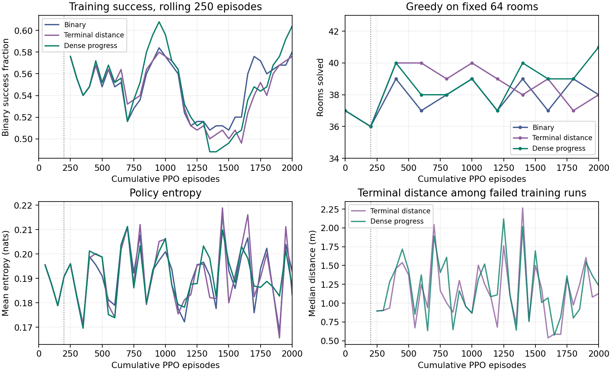
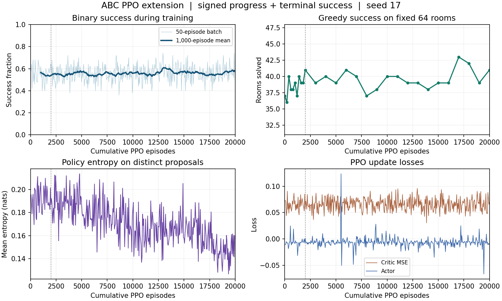
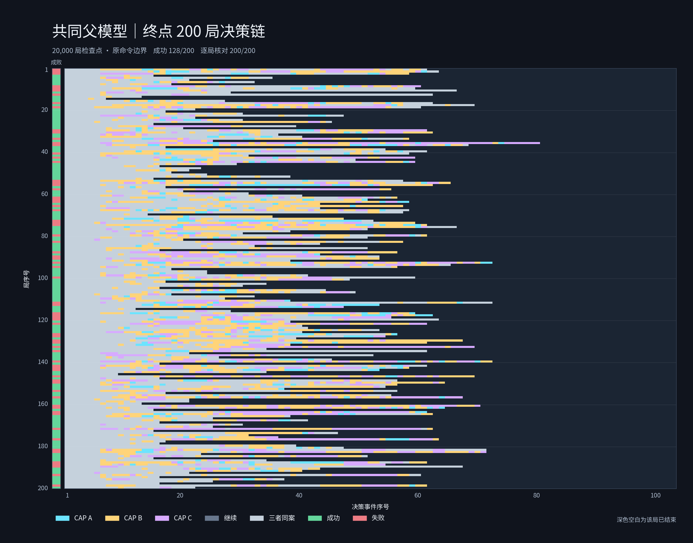
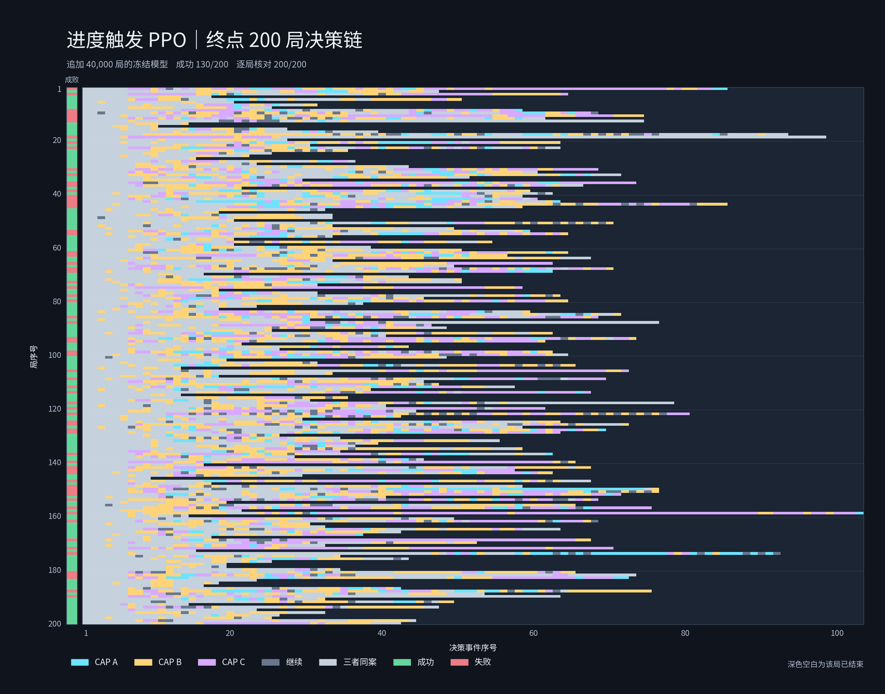

# CoImagine 阶段汇报｜多专家程序策略的闭环组合

**2026 年 11 月 24 日**

## 1. 研究问题与阶段结论

在连续二维双机器人协作推运中，能否组合多个程序专家的能力？每条 option 执行前，冻结专家各自根据同一条公开历史提出命令，路由选择一条执行。两位机器人执行后的公开反馈用于推进各专家记忆，再做下一次选择。整局是否完成任务是主要评估指标。

- **闭环混合可以产生单专家走不出的成功。** 在 A/B 的 200 间确认面板上，最佳单专家成功 102 间，LLM 编写的程序路由与其蒸馏 actor 都成功 111 间。79 个 A、B 单独均败的房间中，它们分别解出 8 间和 10 间。
- **定向开发第三位专家扩大了能力覆盖。** 在另一批 200 间中，A/B 的纯专家成功并集从 134 扩为 A/B/C 的 142，C 提供 8 个独有成功。用同一个停滞条件强制 B→C 切换却救回 9 间、丢失 33 间。
- **中途改选改变了混合策略的能力覆盖。** 原边界 PPO 从 2,000 续训到 20,000 局，在独立 200 间上 105→107。另一次同房间对照中，进度触发组终点成功 130 间、共同父模型成功 128 间。三专家均失败的 49 间由 4→16，并集内成功由 124→114。

## 2. A/B 的已有闭环证据

| 策略 | A/B 诊断面板 / 200 | A/B 确认面板 / 200 |
|---|---:|---:|
| 单专家 A / B | 107 / 113 | 102 / 101 |
| 两位纯专家的成功并集 | 136 | 121 |
| B 先执行 5 条命令，再交 A | 121 | 106 |
| 冻结 LLM 程序路由 | 125 | 111 |
| 冻结蒸馏 actor | — | 111 |
| 蒸馏 actor ＋ PPO 200 局 | — | 111 / 111 / 109 |
| 随机语义 actor ＋ PPO 200 局 | — | 102 / 99 / 98 |
| 分叉训练父 actor ＋无门控 PPO 2,000 局 | 111 / 121 / 115 | 110 / 114 / 111 |

每列是同一批 200 个房间。三种子顺序为 17、29、43。LLM 路由和蒸馏沿用停滞前执行 A 的门控。无门控 PPO 从首次提案不同起可以切换，屏蔽教师派生语义量。程序路由和蒸馏的 111/200 各自包含 11 个对方没解决的房间。最初报告的 118/200 使用旧感知和另一批房间。[A/B 同房间比较](../../key_findings/2026-11-23_distilled_ppo/panel_comparison.md) · [前期 A/B 路由实验](../2026-11-24_cap_routing/README.md)

---

## 3. 为什么要开发 C，为什么停滞触发不够

**首次分歧很难直接预判哪条纯路线会赢。** 在 A/B 独胜的 52 个房间中，首次分歧处的线性评分 AUC 为 **0.465**，95% 区间 [0.312, 0.624]。相同 48 个两路仍在运行且能看见目标的房间，首次评分 AUC 为 **0.497**，分叉各走 10 条命令后用实际测得的物体余距区分，AUC 为 **0.762**。这说明部分信号在动作执行后才出现。双后缀数据来自离线分叉，线上策略只能见到自己实际走到的前缀。[首次分歧对照](../../key_findings/2026-11-23_first_choice_transfer/README.md)

**C 从 A/B 共同失败前缀开发。** 让 6.2sol 读取两份源码和 24 个公开开发前缀，其中 16 个两专家都失败，8 个由原专家自行恢复，A、B 各提供一半。两次完整试跑均救 2 间、丢 2 间，救回案例不同。选用了执行 ticks 更少的第二版。第三版超出 48 KiB 源码上限，在物理试跑前被拒绝。[C 的开发与冻结](../../key_findings/2026-11-23_authored_third/README.md)

| C 独立确认面板 | 任务成功 / 200 | A、B 均失败的 66 间中解出 |
|---|---:|---:|
| 全程 A | 93 | 0 |
| 全程 B | 121 | 0 |
| 全程 C | 98 | 8 |
| A 首次停滞后交 C | 99 | 9 |
| B 首次停滞后交 C | 97 | 7 |

纯专家并集 **134 → 142/200**。加入两条固定接手路线后的事后并集为 **143/200**，其中 1 间只靠固定接手解出。A→C 相对继续 A 救回 29 间、丢失 23 间。B→C 相对继续 B 救回 9 间、丢失 33 间，差为 **−12.0** 个百分点，配对区间 **[−18.0, −6.0]**。因此，**扩大候选路线的覆盖和学会何时使用这些路线，需要分别验收。** 这些事后并集记录的是所测路线的覆盖，对可部署路由还要做实际闭环。[C 确认面板与配对结果](../../key_findings/2026-11-23_authored_third/rooms.csv)

**语义结构还有诊断价值。** 较早的物理审计中，满足所需侧面接触的 PUSH 有 46/49 达到推进标准，其余为 31/96。六类几何局面可以描述这些条件，但按簇统一选择接手专家，只把持续 A 的 194/400 提到 195/400。逐前缀在两条实测后缀里事后挑胜者是 223/400。局面图能帮助定位瓶颈，簇内还缺少足够细的接手依据。[局面与物理前置条件](../../key_findings/2026-11-23_cap_topology_graph/README.md)

---

## 4. 从 A/B 教师路由迈向可扩展的 A/B/C 学习路由

A/B 的程序教师经 72 次试跑选版。蒸馏使用 400 个开发房间的 6,898 个可改选边界，留出教师前缀的动作一致率为 90.6%。在相同交接门控、网络与输入下，蒸馏起点相对随机初始化领先 **5.50** 个百分点；每种子训练 200 局后领先 **5.33**。因此，对照 PPO 要保留冻结的监督起点，才能量到在线更新的增量。[A/B 蒸馏](../../key_findings/2026-11-23_router_distill/README.md) · [同架构短程 PPO](../../key_findings/2026-11-23_distilled_ppo/README.md)

A/B/C 路由由同一个网络给所有候选命令打分。训练样本来自 200 个开发房间的纯专家成功轨迹，共 3,687 个有分歧边界，按房间、成功专家和轨迹边界抽样。基础组读公开几何、动作及最近四次边界。语义组额外读四个作者定义的量，涉及保持有效推动、保持接触准备、改变重复停滞的动作意图及双推方向对抗。作者只读 24 个公开开发片段，没有编写三专家教师程序，两组 critic 都只采用基础输入。

| A/B/C 语义消融的独立 200 间 | 三种子成功数 | 平均成功率 |
|---|---:|---:|
| 同场纯 A / B / C | 85 / 100 / 100 | — |
| 基础输入监督起点 | 103 / 104 / 105 | 52.00% |
| 加作者语义的监督起点 | 108 / 105 / 108 | 53.50% |
| 基础输入 ＋ PPO 200 局 | 102 / 110 / 105 | 52.83% |
| 加作者语义 ＋ PPO 200 局 | 113 / 106 / 108 | 54.50% |

语义组相对基础组的差在监督阶段已是 **+1.50** 个百分点，PPO 后为 **+1.67**，后者区间 **[−2.33, +5.67]**。在线增量之差仅 **+0.17** 个百分点，区间 **[−2.00, +2.33]**。16 个仅 C 成功的房间里，PPO 后基础组分别解出 **6、7、7** 间，语义组 **8、5、5** 间。70 个三专家都失败的房间中，基础组分别解出 **6、9、6** 间，语义组 **11、8、7** 间。[语义消融与逐房间数据](../../key_findings/2026-11-23_abc_semantic_ppo/README.md)

**评估解读。** 这里显示成功轨迹可提供有能力的起点，并能在部分场景组合专家。三组不同来源的 200 房间用于不同实验，分数直接横比会混入房间差异。A/B 与 A/B/C 已有 PPO 还存在训练起点、网络输入和实际训练房间数的差异。要衡量 C 对混合 actor 的独立贡献，需要在同一评分器与同一房间上做 A/B 和 A/B/C 的受控对照。

---

## 5. PPO 预算与奖励信号的同房间对照

固定基础输入 seed 17，从同一 200 局父模型出发，追加相同的 1,800 个训练房间。执行器、随机数规则和任务成功判定一致。三组仅改变训练回报，主评估仍是整局是否成功。

| 奖励 | 末轮固定诊断 64 间 | 末轮同一 200 间 | 相对二元末轮的成功率差 |
|---|---:|---:|---:|
| 二元终端成败 | 38 | 100 | — |
| 失败按终端距离给分 | 38 | 99 | −0.50 [−4.50, +3.50] |
| 每条 option 按靠近量给分 | 41 | 98 | −1.00 [−5.50, +3.00] |

共同 200 局父模型为 **105/200**。终端距离组成功给 1，失败给 0.25 × exp(−d/1 m)。逐步组每净靠近 1 m 给 0.10，后退给 0，成功另给 1。逐步组相对二元组救回 8 间、丢失 10 间。在两组都失败的 92 间，平均终距配对差仅 **+0.003 m**，区间 [−0.101, +0.113]。终距取仿真真值，仅用于训练奖励和离线诊断。[距离奖励](../../key_findings/2026-11-23_abc_ppo_distance/README.md) · [逐步进展奖励](../../key_findings/2026-11-24_abc_ppo_dense/README.md)

两种奖励的 36 个对应训练批次中，二元组与逐步组成功数相关 **0.913**。首批行为轨迹相同，实际 Adam actor 更新方向余弦为 **0.959**，之后更新方向逐步分开。相同的房间次序和相似的策略起点可以解释这些同步的批次波动。固定房间闭环和配对末轮结果较能辨别真实增益。此轮结果限于同一个种子和此前已查看的面板。

---

## 6. 20,000 局续训的闭环效果

**追加 18,000 个新房间后，固定末轮在独立 200 间上成功 107 间，2,000 局父模型成功 105 间。** 末轮救回 15 间、丢失 13 间，配对差 **+1.00 [-4.00, +6.00]** 个百分点。该面板最佳单专家 B 成功 102 间，监督起点成功 96 间。末轮按训练前的协议预先指定。 [独立评估与逐房间结果](../../key_findings/2026-11-24_abc_ppo_extended/README.md)

固定 64 间贪心诊断由 **41→41**。训练的首末两段各 1,000 局，随机策略成功率 **54.1%→57.5%**，动作熵 **0.188→0.148**。两段的训练房间不同。续训固定 seed 17，从 2,000 局恢复 actor、critic 和 Adam，每轮 50 个新房间，靠近 1 m 给 +0.10、后退 1 m 给 −0.10、成功给 1。估计对应扩预算、扩大场景覆盖和后退惩罚共同变化后的效果。[长训协议](../../key_findings/2026-11-24_abc_ppo_extended/plan.md)

**随后对照了决策时机。** 在 12 个开发房间，新增检查点全部选择继续时逐轨迹复现原版。0.6 秒的定时对照接近开发测台上的事件触发频率。第 7 节给出长程对照结果。[事件管线验收](../../key_findings/2026-11-24_abc_ppo_event_preflight/README.md)

---

## 7. 进度事件是否让 PPO 更有效

从同一个冻结的 20,000 局父模型出发，三组各追加 40,000 局，逐轮使用相同的 50 间新训练房间。定时组每 0.6 秒检查。进度组在单推稳定接触及此后每推进 0.20 m 时检查。两组在中途均可继续当前命令或改选 CAP 提案。两个检查点各使用一张事先冻结、独立的新 200 间面板。

| 策略 | 追加 25,000 局 / 200 间 | 追加 40,000 局 / 200 间 |
|---|---:|---:|
| 共同 20,000 局父模型 | 109 | 128 |
| 原命令边界 PPO | 110 | 124 |
| 每 0.6 秒检查 PPO | 126 | 124 |
| 接触／推进事件 PPO | **126** | **130** |
| 同面板最佳单 CAP | 115（C） | 117（B） |

**中途检查有阶段性优势。** 25,000 局时两种检查相对原边界均高 **8 个百分点**。40,000 局时，进度组相对原边界和定时组均领先 **3 个百分点**，配对 95% 区间均为 **[−4, +10]**。相对共同父模型，进度组救回 27 间、丢失 25 间，净增 **1 个百分点**，区间 **[−6, +8]**。固定 64 间的进度组贪心评估从 37 升至 44，定时组从 36 升至 40，原边界组从 41 降至 39。

**更显著的变化是哪些房间能解。** 在终点新 200 间，三专家均失败的 **49 间中成功数从 4 升到 16**。在至少一位专家成功的 **151 间中，父模型解出 124 间，进度组解出 114 间**。新增能力与已有成功的保留共同决定终点净收益。

本轮固定 seed 17，匹配训练房间与 episode 预算。进度组实际获得了更多可改选机会和梯度步。因此，这轮直接检验的是中途改选的整套训练配置，进度触发时机的独立收益仍有不确定性。[完整配对结果](../../key_findings/2026-11-24_abc_ppo_event_comparison/README.md)

---

## 8. 父模型与进度 PPO 的逐局决策链

两张矩阵使用同一批 200 个终点房间、相同的局序号和横轴范围。横轴按各自的决策事件递增。沿同一行左右比较可以看到两个模型在同一房间里的行为，若要比较具体的物理时刻，可按逐事件记录中的 tick 对齐。

青、金、紫分别表示 CAP A、B、C，浅灰表示三位专家提出相同命令，深灰表示中途明确选择继续。左侧绿／红条代表整局成败。父模型记录 8,473 个事件，进度组记录 9,297 个事件，其中 991 次中途改选。两模型各 200 局均用冻结权重重放，公开历史哈希、执行 ticks 与评估成败逐局一致。[图例、逐局数据与复核](../../key_findings/2026-11-24_abc_ppo_event_comparison/README.md)
