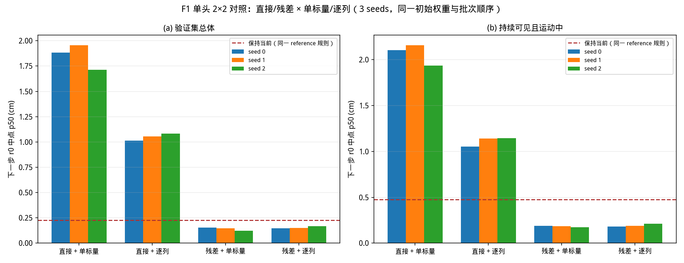
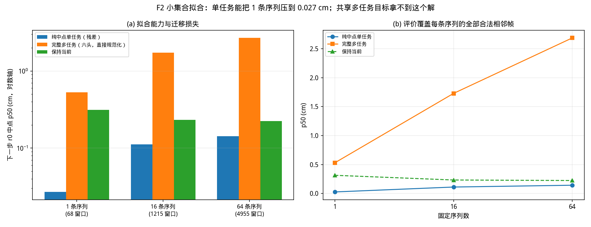
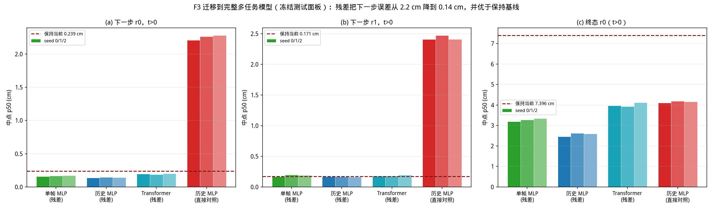

# RESULTS — 残差预测器开发轮（v1）

任务书：`docs/tasks/20261014_CoImagine_Residual_Development_v1.md`。
状态：**阶段门槛通过，残差已成功迁移到完整多任务模型**（任务书第 9 节允许结果 ①）。

## 0. 结论

**把两机器人中点的 x/y 从「直接预测位置」改为「当前位置＋预测位移」，在完整多任务模型上把下一步
误差从 2.2 cm 降到 0.14 cm（约 16×），并首次优于「保持当前」基线。** 推荐冻结配置为
**历史 MLP ＋ 残差 ＋ 按组单标量归一化**（`mlp_history_residual_per_group_seed0`）。

同时必须如实记录两条保留意见：

1. **配对中位差并不支持"全面优于保持基线"。** 残差模型在边际 p50、p90 和运动中子集上明显更好，
   但**逐窗口配对**后，中位差是 **+0.005 至 +0.018 cm**（两个 seed 的 95% CI 不含 0，方向对模型不利）：
   在占多数的近静止窗口上，「保持当前」本来就几乎精确，模型反而略差。模型的收益在**尾部**与
   **运动样本**，不在典型窗口。
2. **机器人 1 的下一步中位数没有超过它的保持基线**（r1：模型 0.165–0.177 cm，基线 0.171 cm，
   基本持平）。收益主要落在机器人 0 与运动样本上。

## 1. 阶段一：接口与行为检查

`targets.py` 是本轮唯一的目标变换入口：`encode_target` / `decode_prediction` /
`encode_geometry` / `decode_geometry`。模型 `forward` **只输出标准化数值**，绝不在内部加米制参考值。
对残差参数化，`decode_prediction` 恰好加一次参考值，且

- `network_output = -mu/sigma` 时**精确**还原保持预测（误差 0.0）；
- 若把输出层偏置设为该值，则 `network_output = 0` 也精确等于保持预测（两种归一化都验证通过）；
- `mu != 0` 时零输出**不是**零位移，报告中不混用这两个说法。

参考值只用当前或过去**可见**观测：当前片段可见取当前中点，否则取 R_i0 固定原点（数值零）。
6 项行为检查见 `tests/test_residual_prediction_v1.py`，含"改未来不改变参考值""不可见占位值不进入
统计/损失/指标""在线与离线解码一致"。

## 2. 阶段二：2×2 单头对照（验证集，3 seeds）

同一初始权重、同一批次顺序、loss 与指标全部按目标可见性 mask：

| 配置 | seed0 | seed1 | seed2 | 运动中 seed0 |
|---|---:|---:|---:|---:|
| 直接 + 单标量 | 1.884 | 1.957 | 1.712 | 2.102 |
| 直接 + 逐列 | 1.014 | 1.055 | 1.081 | 1.051 |
| **残差 + 单标量** | **0.154** | **0.147** | **0.123** | **0.190** |
| 残差 + 逐列 | 0.145 | 0.151 | 0.167 | 0.181 |
| 保持当前 | 0.225 | — | — | 0.475 |

（单位 cm，下一步 r0 中点 p50。）

**门槛判定**：残差两种归一化**全部 3 个 seed** 的验证总体中位都优于保持基线，且"持续可见且机器人
运动中"子集 **3/3** 优于基线（要求 ≥2）；p90 相对基线变化 −3.6% 至 −21.0%，**没有**超过 +10% 的
恶化。门槛通过。

**逐列归一化帮的是直接参数化，不是残差。** 直接参数化 1.88→1.01 cm，残差几乎不变
（0.141→0.154 均值，且跨 seed 不稳定）。本轮选择 `residual + per_group` 迁移。

**这条对照说明的是工程配置差别，不是纯结构效应。** 残差与直接的目标振幅相差约 31 倍，
逐列对照正是用来暴露这一点的。

## 3. 阶段二：小集合拟合（评价覆盖每条序列的全部合法相邻帧）

| 固定序列数 | 评价窗口 | 纯中点单任务（残差） | 完整多任务 | 保持当前 |
|---:|---:|---:|---:|---:|
| 1 | 68 | **0.027 cm** | 0.531 cm | 0.314 cm |
| 16 | 1215 | **0.112 cm** | 1.729 cm | 0.233 cm |
| 64 | 4955 | **0.143 cm** | 2.687 cm | 0.224 cm |

- 单任务能把 **1 条序列的全部 68 个窗口**压到 **0.027 cm**，说明实现、数据管道与优化本身能拟合；
- 共享多任务目标**拿不到这个解**（0.53 → 2.69 cm，且都差于保持基线）——这就是任务书要求定位的
  **迁移损失**。它是阶段三必须验证的东西：单头有效**不等于**整模型有效。

## 4. 阶段三：迁移到完整多任务模型（12 run，D1，3200 更新，batch 128）

模型规模、头数、损失权重与第 6 轮完全一致，只改中点参数化。直接参数化的对照是**本轮重训**的
（同一协议、同一工程修正），不是旧报告数字。

**冻结测试面板（2048 窗口 / 512 root）**：

| 配置 | 下一步 r0 | 运动中 r0 | 下一步 r1 | p90 r0 | 终态 t=0 r0 | 终态 t>0 r0 |
|---|---:|---:|---:|---:|---:|---:|
| 保持当前 | 0.239 | 0.471 | 0.171 | 0.831 | 16.423 | 7.396 |
| 单帧 MLP（残差） | 0.159–0.173 | 0.225–0.230 | 0.168–0.199 | 0.53–0.55 | 8.91–9.20 | 3.19–3.35 |
| **历史 MLP（残差）** | **0.139–0.145** | **0.177–0.180** | 0.165–0.168 | 0.63–0.67 | 10.42–10.87 | **2.47–2.62** |
| Transformer（残差） | 0.188–0.200 | 0.256–0.271 | 0.175–0.196 | 0.65–0.70 | **7.44–8.34** | 3.93–4.13 |
| 历史 MLP（直接对照） | 2.208–2.278 | 2.030–2.267 | 2.407–2.472 | 5.28–5.64 | 11.68–11.99 | 4.10–4.19 |

（单位 cm；验证面板上的数字与表内一致，见 `main_results_eval_val.json`。）

**root 级配对 bootstrap（2000 次重采样，单位 root）**

| 比较 | 中位差 | 95% CI | root |
|---|---:|---|---:|
| 残差 vs 直接（r0, t>0） | **−2.59 至 −2.68 cm** | 全部不含 0 | 512 |
| 残差 vs 直接（r1, t>0） | **−2.68 至 −2.86 cm** | 全部不含 0 | 421 |
| 残差 vs 保持（r0, t>0） | +0.005 / +0.016 / +0.018 cm | seed0 含 0；seed1、seed2 不含 0 | 512 |

**残差相对直接参数化的改善是确定的**（三个 seed、两台机器人、CI 全部远离 0）。
**残差相对保持基线的配对中位差方向相反**，理由见第 0 节：基线在近静止样本上几乎精确，
模型的 0.14 cm 是"稳定的中等误差"，在逐窗口比较中吃亏。

按运动状态与可见性拆分的完整表格、以及两机器人分别的 p50/p90/RMSE，见
`reference/main_results_eval_test.json`。

## 5. 交付物

| 文件 | 内容 |
|---|---|
| `CONTRACT.md` | 冻结接口：坐标系、单位、列名、参考值、mask、归一化、版本号 |
| `REVIEW_FIXES.md` | 审查 3.1–3.6 六项发现的逐条修正与证据 |
| `RESULTS.md` | 本文件 |
| `CHECKPOINT_INTERFACE.md` | 哪些字段可预测、哪些来自命令/时钟、哪些仍缺失 |
| `F1/F2/F3*.png` | 三张诊断图 |
| `outputs/residual_prediction_v1/` | 24 个单头 + 12 个完整模型检查点、逐样本预测、结果 JSON |
| `residual_prediction_v1_review.zip` | 审查包，含可**实际重算**的验证脚本 |

## 6. 本轮**没有**做的事

不接规划器、不新增 latent 递推、不采集新数据、不扩大模型、不做完整自由 rollout、
不重跑 D2 规模。法向、角度、速度、退出分类保持原参数化。
