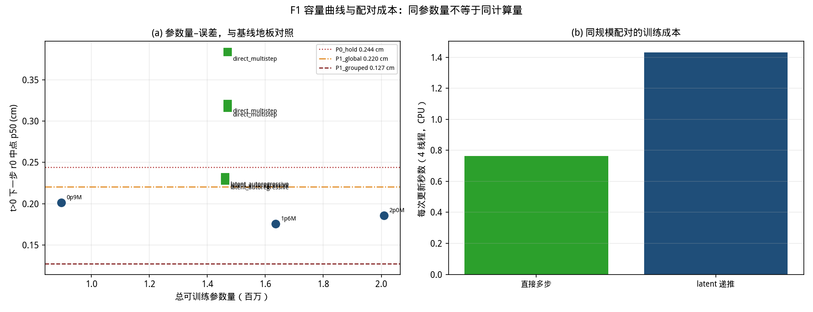
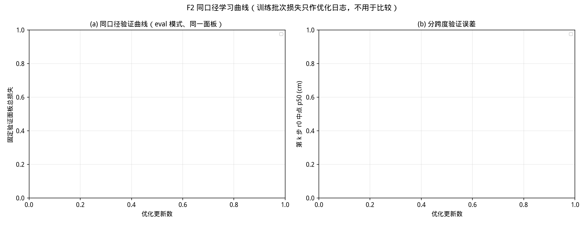
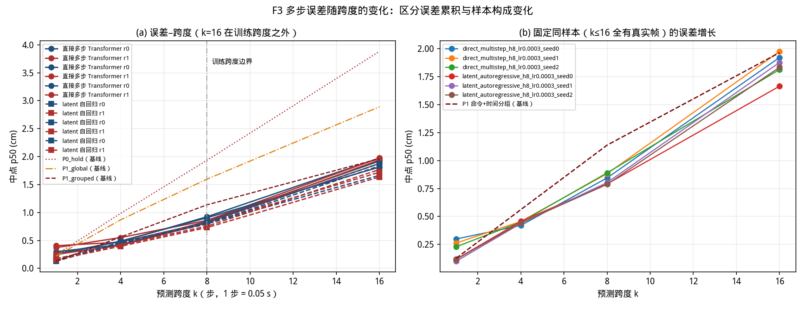
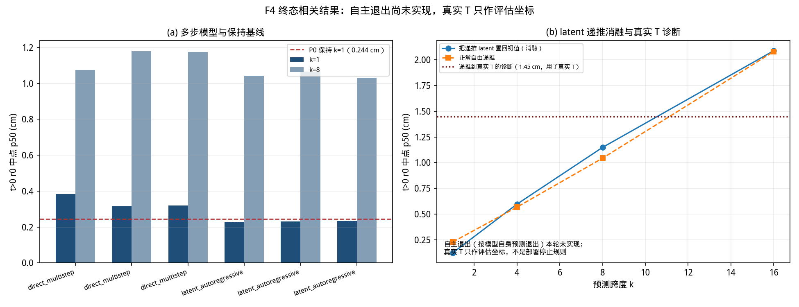
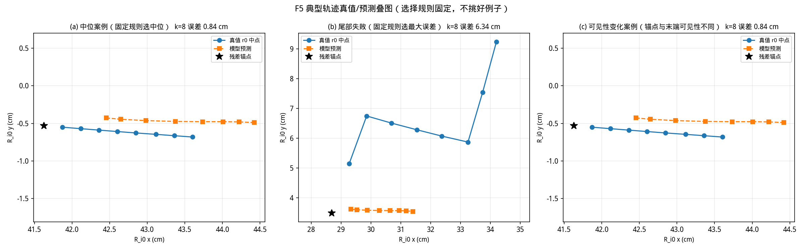

# RESULTS — Transformer 扩容与同规模 latent 自回归（v1）

任务书：`docs/tasks/20261014_CoImagine_Transformer_Scale_Latent_AR_v1.md`。
设备：**CPU**，24 逻辑核，torch 2.14.1+cpu；开工提交 `0f965fa`。

## 0. 一页结论

1. **两个学习模型都没有稳定超过一个平凡的查表基线。** 在机器人 0、已有真实前缀 `t>0` 上，
   "双方命令 ＋ 已执行时间 bin"查表（P1_grouped，键含两台机器人的 active 标志，723 组，
   测试面板命中率 97.5%）的中点中位误差：**k=1 为 0.127 cm**，而直接多步三个种子是
   0.316 / 0.321 / 0.384 cm、latent 是 0.228 / 0.230 / 0.232 cm。
   **k=1 上基线的优势（≥0.10 cm）远大于两个模型族的种子极差（0.068 / 0.004 cm），因此稳健。**
   模型只在 **k=8** 稳定反超基线（latent 1.030–1.065 对 1.137 cm），到 **k=16**（跨度外推）
   又落后（latent 2.081–2.370 对 1.963 cm）。
2. **同规模配对中，latent 在两端稳健更好，k=4 打平。**
   k=1：latent 0.228–0.232 对直接 0.316–0.384，**区间不重叠**；
   k=4：latent 0.567–0.620 对直接 0.571–0.629，**区间重叠 → 分不出**；
   k=8：1.030–1.065 对 1.074–1.179，刚好不重叠，优势很小；
   k=16：2.081–2.370 对 2.760–2.957，**区间不重叠**。
3. **但 latent 的递推本身几乎不起作用。** 把递推 latent 每一步都置回初始编码（消融），
   误差几乎不变：seed0 为 k1 0.122（正常 0.228）、k4 0.596（0.567）、k8 1.148（1.043）、
   k16 2.089（2.081）。**收益来自初始编码＋读出，不来自"把 latent 往前推"。**
4. **扩容的收益落在种子噪声之内。** 直接预测 Transformer 从 895,937 增到 1,635,569 参数
   （1.83×），`t>0` 下一步 0.201 → 0.176 cm（−12.4%）；再增到 2,009,569（+23%）反而回到
   0.186 cm。而同一直接多步模型族的 **seed 极差是 0.068 cm**，大于那 0.025 cm 的"改善"。
   **因此不能声称扩容带来了可靠改善。** 代价却是实打实的：batch=128 延迟
   172.7 → 305.2 → 366.8 ms。

**尚未评估闭环决策收益**：本轮未接规划器。

## 1. 任务难度：这个目标几乎是确定性的

在公开键（双方命令 ＋ 已执行时间 bin）相同的窗口内，第 1 步中点的**组内离散度中位数只有
0.0517 cm**。知道命令和时间之后，未来一步几乎已经确定。这解释了为什么一个**完全不分组**的
全局中位位移（P1_global）就有 0.220 cm，而"保持当前"（P0_hold）是 0.244 cm。

**本轮所有模型数字都必须与这三条地板一起读。**

## 2. 主表：机器人 0，`t>0`，中点二维误差中位数（cm）

`t>0` 1486 窗口；`t=0` 559 窗口另列于 `TABLES.md`。

| 模型 | 参数量 | k=1 | k=4 | k=8 | k=16（跨度外推） |
|---|---:|---:|---:|---:|---:|
| P0 保持当前 | — | 0.244 | 0.985 | 1.934 | 3.882 |
| P1 全局位移（不分组） | — | 0.220 | 0.870 | 1.596 | 2.891 |
| **P1 命令＋时间分组** | — | **0.127** | 0.562 | 1.137 | **1.963** |
| 直接多步 Transformer（3 seed） | 1,469,952 | 0.316 / 0.321 / 0.384 | 0.571 / 0.607 / 0.629 | 1.074 / 1.174 / 1.179 | 2.760 / 2.924 / 2.957 |
| latent 自回归（3 seed） | 1,461,600 | **0.228 / 0.230 / 0.232** | 0.567 / 0.598 / 0.620 | **1.030 / 1.043 / 1.065** | 2.081 / 2.309 / 2.370 |

**逐跨度判读（以三个种子的极差为准，不以单个数字为准）**

| 跨度 | 谁更好 | 是否稳健 |
|---|---|---|
| k=1 | P1 分组查表 0.127 ≪ 两个模型 | **稳健**（差距远大于种子极差） |
| k=4 | P1 0.562 与 latent 0.567–0.620 几乎相同 | 分不出 |
| k=8 | latent 1.030–1.065 < P1 1.137 | 稳健但幅度小（约 0.09 cm） |
| k=16 | P1 1.963 < latent 2.081–2.370 < 直接 2.760–2.957 | **稳健**（基线更好） |

## 3. 配对比较：两个统计量必须并列

"直接多步 seed0 − latent seed0"，单位 cm；负值偏向直接多步。

| 跨度/机器人 | 误差中位数之差 | 逐样本差值中位数 | 95% CI（root 级，2000 次） | 判读 |
|---|---:|---:|---|---|
| k=1 r0 | +0.170 | +0.091 | [+0.077, +0.114] | latent 更好 |
| k=1 r1 | +0.243 | +0.130 | [+0.089, +0.180] | latent 更好 |
| k=4 r0 | **−0.028** | **+0.012** | [+0.008, +0.016] | **两统计量方向相反 → 不分胜负** |
| k=4 r1 | +0.006 | −0.000 | [−0.005, +0.004] | 分不出 |
| k=8 r0 | +0.044 | +0.170 | [+0.145, +0.191] | latent 更好 |
| k=8 r1 | +0.018 | +0.090 | [+0.075, +0.102] | latent 更好 |
| k=16 r0 | +0.256 | +0.244 | [+0.183, +0.352] | latent 更好（跨度外推） |
| k=16 r1 | **+0.157** | **−0.104** | [−0.197, −0.034] | **两统计量方向相反** |

k=4 与 k=16(r1) 正是任务书警告过的情形：**两个统计量给出相反方向，不能互相替代。**

## 4. latent 递推消融：递推几乎不起作用

把展开过程中的 latent 每一步都替换为初始编码（保留同样的 decoder 与 horizon 编码），
误差几乎不变（前 512 窗口）：

| 种子 | k=1 正常 / 冻结 | k=4 | k=8 | k=16 |
|---|---|---|---|---|
| 0 | 0.228 / **0.122** | 0.567 / 0.596 | 1.043 / 1.148 | 2.081 / 2.089 |
| 1 | 0.230 / **0.139** | 0.620 / 0.670 | 1.065 / 1.161 | 2.370 / 2.169 |
| 2 | 0.232 / **0.140** | 0.598 / 0.599 | 1.030 / 1.174 | 2.309 / 2.187 |

**k=1 上冻结反而更好**；其余跨度冻结只差 0.03–0.14 cm。
→ 当前实现里，"latent 自回归"实际是一个"从真实前缀编码一次、再用共享 decoder 读出"的模型；
递推链没有承担信息。这正面回答了任务书"至少做一次将递推 latent 置为初始值的推理消融"的要求：
**多步预测不依赖递推。**

## 5. 容量曲线（直接预测 Transformer，同一协议）

| 配置 | 参数量 | 相对目标 | `t>0` k=1 | `t>0` p90 | `t=0` k=1 | batch1 ms | batch128 ms |
|---|---:|---:|---:|---:|---:|---:|---:|
| `(128,4,512)` | 895,937 | 0.90M −0.4% | 0.201 | 0.798 | 0.283 | 3.25 | 172.65 |
| `(176,4,704)` | **1,635,569** | 1.60M +2.2% | **0.176** | 0.721 | 0.117 | 5.44 | 305.18 |
| `(176,5,704)` | 2,009,569 | 1.60M +25.6% | 0.186 | 0.741 | 0.098 | 6.65 | 366.75 |

**读法**：0.90M → 1.64M 的中位改善是 **0.025 cm**，而直接多步模型族的种子极差是 **0.068 cm**，
1.64M → 2.01M 还反向。**三个点各只有 seed 0，差异小于已观测到的种子波动，因此不能声称
容量带来了可靠改善。** 唯一确定的是成本随规模上升。

## 6. 同规模配对的实际定义

| 模块 | 直接多步 | latent 自回归 |
|---|---:|---:|
| encoder | 1,246,880 | 1,246,880 |
| transition | — | 105,440 |
| decoder | 168,984 | 76,824 |
| heads | 54,088 | 32,456 |
| **合计** | **1,469,952** | **1,461,600** |

总参数差 **0.57%**，两侧 encoder **完全相同**；差别是"把参数花在递推还是花在读出头上"。
**这不等价于相同容量。**

## 7. 训练与成本

- 全部配置：3200 次更新、batch 128、AdamW、lr 3e-4（seed 0 上以 1e-4 / 3e-4 短试验在固定验证
  面板选出：1000 次更新时 5.400 对 4.328）、余弦退火到 3e-5、梯度裁剪 1.0。
- 训练日志里的批次损失只作优化日志；一切比较使用 eval 模式下的固定面板。
- **同参数量不等于同计算量**：4 线程下直接多步 0.763 s/更新、latent 1.431 s/更新（约 1.9×），
  峰值 RSS 1.50 / 1.84 GB；3200 次更新分别约 41 / 76 分钟。
- 长程诊断：递推到**真实 T**（仅作评估坐标）在 444 个窗口上 p50 1.45 / 1.68 / 1.54 cm，
  p90 最大到 20.0 cm，尾部不稳定；该跨度超出训练的 0.40 s，属外推。

## 8. 未完成项（不得计入结论）

| 项 | 状态 |
|---|---|
| 约 4.15M 容量点 `(256,5,1024)` | 中断时 600/3200，**未完成** |
| 自主退出 / 未终止率 / 停止时间误差 | **未实现**（需条件退出概率头与退出标签核验；不以直接终态头冒充） |
| 1/16 条完整序列的小集合拟合与梯度检查 | 未单独记录 |
| D2 扩展 | 未开展 |

一次外部中断终止了全部训练进程并吞掉约 4.5 小时机时；已落盘的检查点与逐样本预测不受影响。
**恢复方式**见 `STATUS.md`；`run_matrix.py --stage a` / `--stage c` 均可断点续跑。

## 9. 结论措辞约束（逐条对照）

- 小模型负结果**不**否定整条 Transformer 路线 → 只报"当前规模与预算下未见可靠收益"。
- 同参数量**不**等于同计算量或同预测能力 → 第 6、7 节分开列出。
- latent 优于原下一步模型**不**证明 latent 结构优势 → 第 4 节的消融说明本轮连"递推本身有用"
  都不成立。
- 直接终态头改善**不**称为长期自由递推改善。
- 真实 `T` **只**作评估坐标；自主停止规则未实现。
- 确定性 latent **不**自动解决状态歧义。
- 本轮改进属于**预测器能力**变化；后续规划对照须用同一组冻结检查点。

## 10. 建议冻结与下一步

**不建议冻结任何多步检查点**：两个 1.6M 配对模型在 k=1 上都没有跨过第 1 节的基线地板，
且 latent 的递推经消融证明几乎不参与预测。

**可继续使用的是单步配置** `capacity_0p9M_seed0`（895,937 参数，`t>0` 0.201 cm，
batch=1 延迟 3.25 ms）：本轮唯一稳定优于保持基线、成本又低的检查点。

**建议的下一项最小诊断（按顺序）**

1. **先查为什么查表能在 k=1 上赢。** 既然组内离散度只有 0.05 cm，就应把
   "以 (命令, 已执行时间) 为条件的条件中位位移"作为**残差基准**交给模型，而不是让它从零学；
   若模型仍学不到，问题在损失或读出结构，不在容量。
2. **让递推真正承担信息**：冻结 latent 几乎不改变输出，说明梯度没有流经有效路径。
   应先做一个"只在递推输出上接损失"的诊断，确认 `z_k` 确实被训练到。
3. 上述两项解决后**再**补 4.0M 点与 D2 扩展；在此之前扩容只是在放大一个未被使用的递推。
